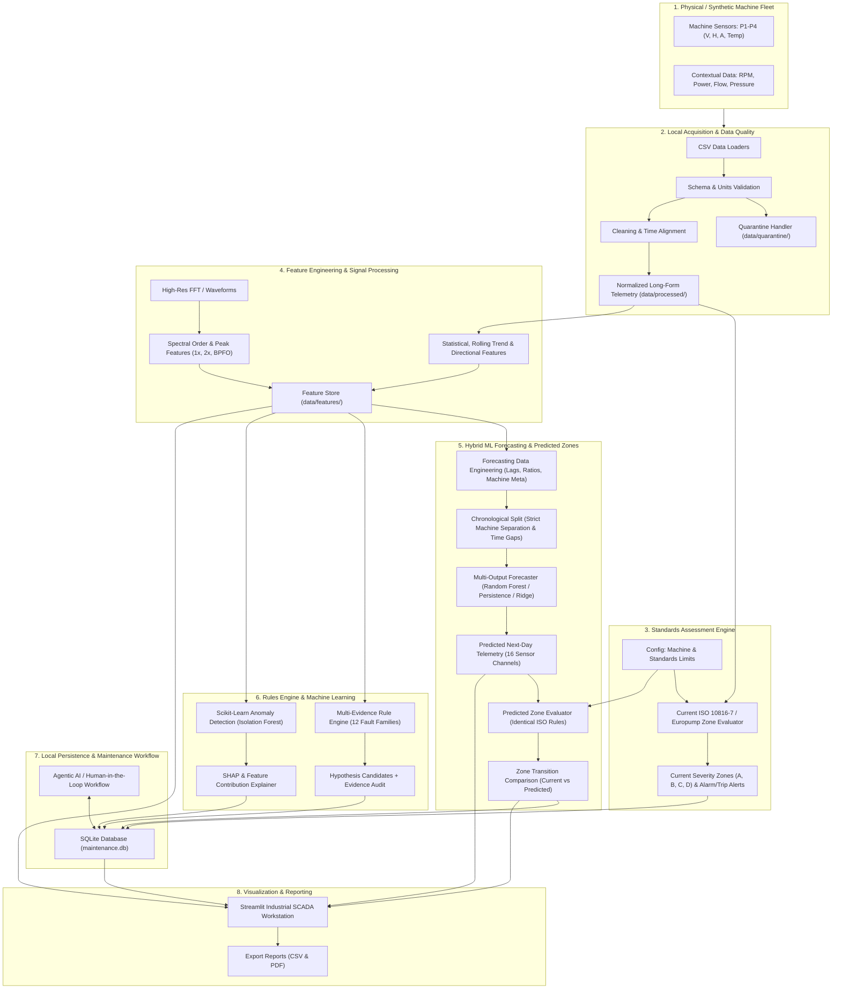

# System Architecture and Design Specification

**Project:** Intelligent Predictive Maintenance Framework for Smart Manufacturing  
**Target Environment:** Local Python, SQLite, Streamlit, Scikit-learn, Plotly  
**Safety Philosophy:** Independent safety protection. The AI, ML models, and dashboard act as diagnostic decision support and must never directly actuate plant machinery.

---

## 1. High-Level Architecture Overview

---

## 2. Core Architectural Principles

1. **Local-First & Zero External Dependencies:**  
   The application operates 100% on local files, local SQLite databases, and standard Python libraries. No external cloud credentials, hosted endpoints, or telemetry streaming brokers are required.

2. **Decoupled Diagnostic Evidence vs. Severity Zones:**  
   Vibration severity zones (A, B, C, D) from ISO 10816-7 quantify *severity*, not *fault cause*. A Zone D reading indicates high damage risk, but does not identify whether the issue is unbalance, misalignment, or bearing degradation. The rule engine synthesizes multi-directional, multi-location, and spectral evidence to formulate candidate hypotheses.

3. **Deterministic Quarantine & Non-destructive Processing:**  
   Raw files are never altered or overwritten. Records with corrupted timestamps, missing machine IDs, or invalid ranges are cleanly separated into `data/quarantine/` with documented error reasons.

4. **Incomplete Configuration Safety:**  
   If machine classification, nominal power, or measurement parameters are unknown, the system refuses to guess a severity threshold and explicitly reports:  
   `Not evaluable — machine configuration or applicable criterion is incomplete`.

5. **Human-in-the-Loop Maintenance Records:**  
   Diagnostic candidates and anomaly alerts require human acknowledgement, work-order drafting, and sign-off before entering the maintenance execution log.

6. **Strict Machine Boundary Separation & Time-Gap Invalidation:**  
   In the forecasting pipeline, features and targets are computed strictly per machine. Targets never cross asset boundaries (the target for the final day of M1201 is never the first day of M1202). Any time step gap $> 1.0$ day between consecutive records invalidates the target (set to NaN), preventing false interpolation across shut-downs.

7. **Zero Lookahead Data Leakage:**  
   Features at forecast time $t$ are derived solely from historical data $\le t$. Ground truth targets at $t+1$ are isolated until evaluation. Evaluation metrics (MAE, RMSE, $R^2$) are computed exclusively on chronologically held-out unseen test samples.

8. **Dual-Zone Consistency:**  
   Predicted telemetry values pass through the exact same configurable ISO 10816-7 / Europump 2013 Table 1 rule engine as current telemetry. If an asset is incomplete (`M1205`), both current and predicted zone evaluations return the refusal message.

---

## 3. Hybrid ML Forecasting Technical Specifications

### Multi-Output Target Channels (16 Channels)
The model forecasts all physical channels simultaneously:
- **Vibration Velocity RMS (mm/s):**
  - Point 1 (Pump Non-Drive End): Radial Vertical (`P1_V`), Radial Horizontal (`P1_H`), Axial (`P1_A`)
  - Point 2 (Pump Drive End): Radial Vertical (`P2_V`), Radial Horizontal (`P2_H`), Axial (`P2_A`)
  - Point 3 (Motor Drive End): Radial Vertical (`P3_V`), Radial Horizontal (`P3_H`), Axial (`P3_A`)
  - Point 4 (Motor Non-Drive End): Radial Vertical (`P4_V`), Radial Horizontal (`P4_H`), Axial (`P4_A`)
- **Bearing Temperature (°C):**
  - Point 1 (`P1_Temp`), Point 2 (`P2_Temp`), Point 3 (`P3_Temp`), Point 4 (`P4_Temp`)

### Engineered Feature Matrix (204 Dimensions per Record)
- **Lag Values:** $t-1, t-2, t-3, t-7$ for all 16 channels (64 features).
- **1-Day Rate of Change:** $y_t - y_{t-1}$ for all 16 channels (16 features).
- **Rolling Window Statistics:** 3-day and 7-day rolling mean, rolling standard deviation, and rolling maximum for all 16 channels (96 features).
- **Directional Mechanical Ratios:** Radial-to-Axial ($R/A$), Horizontal-to-Vertical ($H/V$), and Coupling Axial ratio ($P2_A / P3_A$) (24 features).
- **Machine Metadata Context:** Categorical pump classification, nominal power rating, operational speed, and mount stiffness.

### Verified Multi-Model Evaluation on Unseen Test Data
- **Persistence Baseline:** $\hat{y}_{t+1} = y_t$ (MAE: `0.4820 mm/s`, RMSE: `1.0151 mm/s`, $R^2$: `0.6787`).
- **Ridge Regression:** Multi-output linear regression with L2 regularization (MAE: `0.4080 mm/s`, RMSE: `0.8156 mm/s`, $R^2$: `0.7855`).
- **Random Forest Regressor:** Multi-output ensemble with 100 estimators, max depth 12 (MAE: `0.4240 mm/s`, RMSE: `0.8490 mm/s`, $R^2$: `0.7308`).

